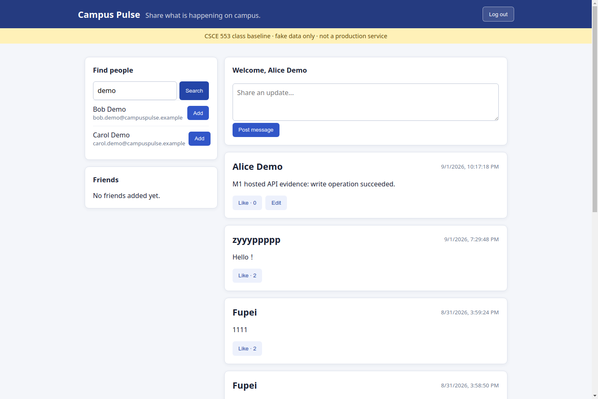

# M1 Baseline System — Evidence

Application URL: <https://campus-pulse-csce553.onrender.com>

Repository URL: <https://github.com/GFP-1011/campus-pulse-csce553>

## Logged-in UI

The screenshot below shows the hosted Campus Pulse UI logged in as Alice Demo, including the dynamic message feed.



## API evidence against the hosted service

The following output was captured from the public hosted service. The bearer token is redacted.

### Health

```text
$ curl -i https://campus-pulse-csce553.onrender.com/health
HTTP/2 200
content-type: application/json
server: cloudflare
x-render-origin-server: uvicorn

{"status":"ok"}
```

### Login

```text
$ curl -sS -X POST https://campus-pulse-csce553.onrender.com/api/auth/login \
    -H 'Content-Type: application/json' \
    -d '{"email":"alice.demo@campuspulse.example","password":"CampusPulseDemo!2026"}'
{"access_token":"REDACTED","token_type":"bearer","user":{"id":3,"email":"alice.demo@campuspulse.example","display_name":"Alice Demo"}}
```

### Write: create message

```text
$ curl -sS -X POST https://campus-pulse-csce553.onrender.com/api/messages \
    -H "Authorization: Bearer $TOKEN" \
    -H 'Content-Type: application/json' \
    -d '{"body":"M1 hosted API evidence: write operation succeeded."}'
{"id":8,"body":"M1 hosted API evidence: write operation succeeded.","author":{"id":3,"email":"alice.demo@campuspulse.example","display_name":"Alice Demo"},"like_count":0,"liked_by_me":false,"created_at":"2026-09-02T02:17:18.044729Z","updated_at":"2026-09-02T02:17:18.044732Z"}
```

### Read: list messages

```text
$ curl -sS https://campus-pulse-csce553.onrender.com/api/messages \
    -H "Authorization: Bearer $TOKEN"
[{"id":8,"body":"M1 hosted API evidence: write operation succeeded.","author":{"id":3,"email":"alice.demo@campuspulse.example","display_name":"Alice Demo"},"like_count":0,"liked_by_me":false,"created_at":"2026-09-02T02:17:18.044729Z","updated_at":"2026-09-02T02:17:18.044732Z"}, ...]
```

All users and content shown here are fake. This is a CSCE 553 class baseline, not a production service.
