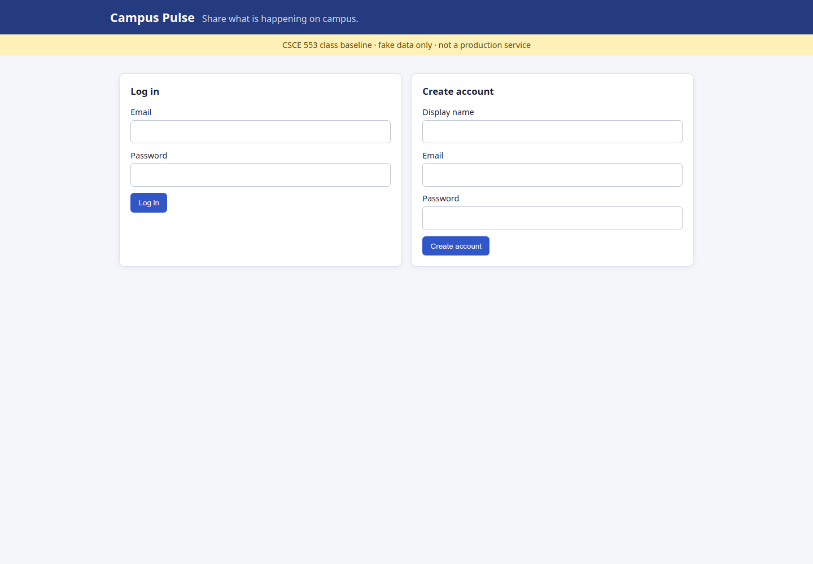
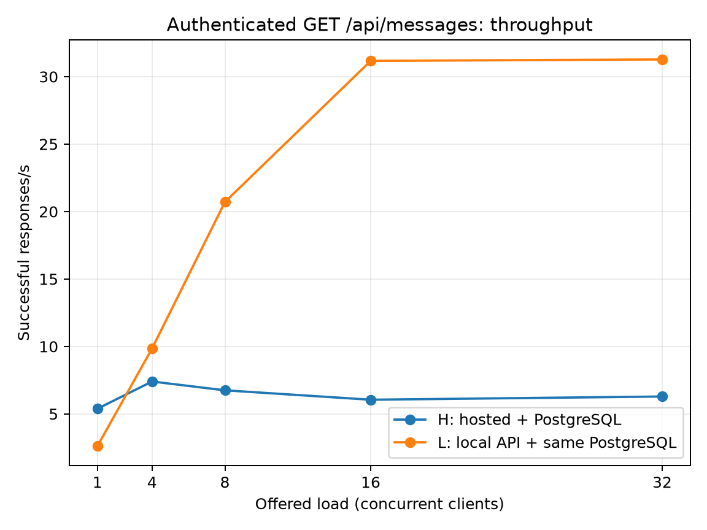
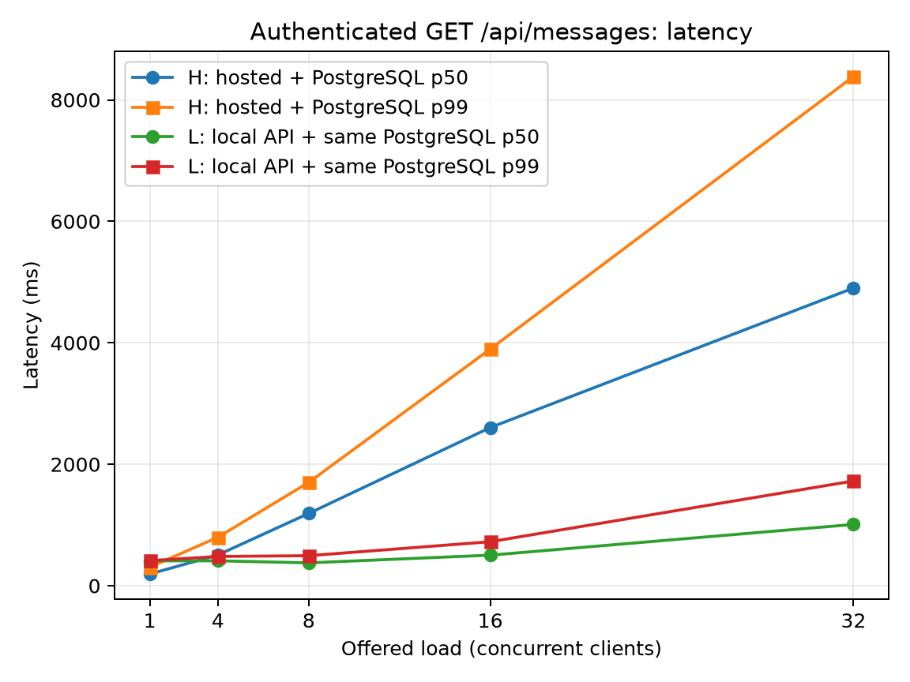
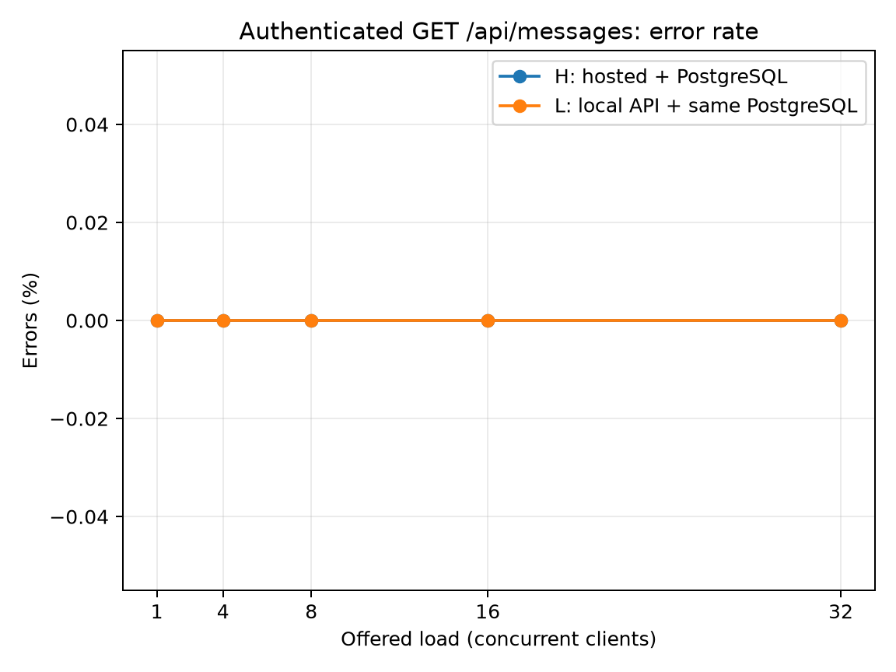

# M2 — Baseline Performance: Campus Pulse

Measurement date: 2026-09-09 UTC  
Baseline commit: `8f0d1bde5ac280ec1cc924bebdfdb7d5efb38ad6`  
Hosted application: <https://campus-pulse-csce553.onrender.com>

## 1. System under test

```text
Browser / load driver -> FastAPI (one Render free web service) -> Supabase PostgreSQL
```

The authenticated read path is `GET /api/messages`; the write path is
`POST /api/messages`; `GET /health` is the control. The feed query is bounded to
100 posts and eagerly loads authors and likes. The hosted response contained 100
rows and was 31,678 bytes. The API uses one reusable SQLAlchemy engine and closes
each request session.



The screenshot's full URL and UTC capture time are recorded in
[`hosted-url.json`](results/hosted-url.json).

## 2. Workload and capacity model

The model was recorded before the capacity sweep in
[`prediction.md`](results/prediction.md). Assumptions: 10% active in the peak
hour, 30 actions per active user per hour, 80% reads/20% writes, 30,000 bytes per
read response, 300 bytes per write response, 200 stored bytes per write, one M1
copy, and four peak-equivalent hours per day.

| Registered | Active | Peak RPS | Write RPS | Logical storage/day | Response bandwidth |
|---:|---:|---:|---:|---:|---:|
| 10,000 | 1,000 | 8.333 | 1.667 | 4.8 MB | 200,500 B/s |
| 1,000,000 | 100,000 | 833.333 | 166.667 | 480 MB | 20.05 MB/s |
| 100,000,000 | 10,000,000 | 83,333.333 | 16,666.667 | 48 GB | 2.005 GB/s |

Indexes, row overhead, WAL, backups, request headers, and TLS overhead are extra.

The pre-measurement prediction was: **the hosted API CPU will be the first limit
on the authenticated read path, observed as throughput flattening and p99
increasing while API CPU rises and PostgreSQL connections remain bounded.**

## 3. Method

The supplied Python closed-loop driver was used with Python 3.13.5. Each stage
discarded a 10-second warmup, measured for 60 seconds, and recovered for 30
seconds. Concurrency was the only load factor changed: 1, 4, 8, 16, then 32.
The stop rules were error rate above 10%, p99 above 5 seconds, or mostly
429/502/503 responses. The stage below the hosted stop was repeated. One write
and one 80/20 mix stage followed. A single bearer token and fixed write body were
used within each series; secrets are excluded from Git.

Series H used the public Render URL and its Supabase database. Series L used the
same code on `127.0.0.1:8000` and the same Supabase PostgreSQL 17.6 database.
The database dialect and connectivity were verified before the L run with
`SELECT 1`; the connection secret was not printed or committed.

After a separate 15-minute idle window, one hosted `GET /health` request returned
HTTP 200 in **32.624475 seconds** (15-byte response). This one-off cold-start
measurement is recorded in [`H-cold-start.txt`](results/H-cold-start.txt) and is
excluded from all warm steady-state percentiles.

## 4. Results

### Hosted series H

| Workload | c | Success RPS | p50 ms | p95 ms | p99 ms | max ms | Error rate |
|---|---:|---:|---:|---:|---:|---:|---:|
| health | 2 | 16.285 | 111.56 | 134.69 | 234.94 | 1173.99 | 0% |
| read | 1 | 5.382 | 193.04 | 213.16 | 304.59 | 1291.83 | 0% |
| read | 4 | 7.401 | 506.43 | 700.64 | 798.36 | 2397.75 | 0% |
| read | 8 | 6.749 | 1190.22 | 1510.79 | 1701.13 | 2200.75 | 0% |
| read | 16 | 6.051 | 2604.74 | 3400.44 | 3897.50 | 4281.04 | 0% |
| read | 32 | 6.289 | 4901.72 | 7205.22 | 8384.65 | 9905.11 | 0% |
| read repeat | 16 | 6.412 | 2400.39 | 3215.29 | 3700.53 | 4104.47 | 0% |
| write | 16 | 15.142 | 1004.76 | 1396.15 | 1671.34 | 1997.07 | 0% |
| 80/20 mix | 16 | 7.027 | 2204.06 | 3001.97 | 3422.51 | 3608.60 | 0% |

Successful read throughput peaked at 7.401 RPS at c=4. Raising concurrency to 8
reduced throughput while more than doubling p99. At c=32, p99 reached 8.385 s
and triggered the stop rule. The c=16 repeat differed by 6.0% in throughput,
well inside the guide's approximate 20% investigation threshold.

The write endpoint was faster than the read feed at the same c=16. The mix was
close to the read result because reads dominate and each read serializes 100
records. Mix therefore changes capacity materially, but does not reveal a
write-first bottleneck.

### Local API series L (same Supabase PostgreSQL)

| Workload | c | Success RPS | p50 ms | p95 ms | p99 ms | max ms | Error rate |
|---|---:|---:|---:|---:|---:|---:|---:|
| health | 2 | 3469.677 | 0.56 | 0.61 | 0.72 | 7.39 | 0% |
| read | 1 | 2.616 | 409.57 | 412.24 | 412.92 | 413.07 | 0% |
| read | 4 | 9.851 | 410.23 | 465.04 | 482.05 | 801.35 | 0% |
| read | 8 | 20.712 | 376.35 | 444.60 | 494.49 | 834.67 | 0% |
| read | 16 | 31.167 | 503.22 | 614.75 | 724.58 | 989.84 | 0% |
| read | 32 | 31.274 | 1008.96 | 1603.32 | 1724.79 | 2526.73 | 0% |
| read repeat | 32 | 31.061 | 1016.62 | 1621.09 | 1734.44 | 3083.18 | 0% |
| write | 32 | 22.593 | 1071.31 | 2592.73 | 3383.44 | 5105.76 | 0% |
| 80/20 mix | 32 | 28.900 | 958.69 | 1762.17 | 2447.16 | 3870.23 | 0% |

Series L read throughput rose through c=16, then flattened at about 31.2 RPS at
c=32 while p99 increased from 724.58 ms to 1724.79 ms. The c=32 repeat differed
by only 0.7% in throughput. The write-heavy workload was slower than the read
workload at this concurrency, so the 80/20 mix reduced throughput to 28.9 RPS.







Figures use 60-second stages from the supplied driver at the baseline commit.
The H and L curves use the same Supabase PostgreSQL database and are not averaged.

## 5. Resources and bottleneck claim

The local API process was sampled every five seconds. Mean CPU rose from 7.0%
at read c=1 to 80.6% at c=16 and 79.9% at c=32. Throughput rose to 31.167 RPS
at c=16 and then flattened at 31.274 RPS while p99 more than doubled. RSS rose
from 86.45 to 98.20 MiB across the staircase. The aligned samples are in
[`L-api-resources.csv`](results/L-api-resources.csv) and
[`notes.md`](results/notes.md).

The evidence supports a **local API/process-or-database-wait knee near c=16--32**:
throughput flattened, CPU stopped rising near 80%, and tail latency rose sharply
while memory remained modest. Because CPU did not saturate, remote database/pool
wait is a material explanation. For hosted H, the throughput/latency shape is
consistent with the predicted API limit, but the prediction is **not conclusively
confirmed** because Render and Supabase dashboard signals are still missing.

## 6. SLO

Proposed lab SLO: **99% of warm authenticated `GET /api/messages` events, after
login and excluding cold start, complete within 4,000 ms over a 60-second stage,
with error rate at or below 1%.** This threshold comes from the hosted c=16 stage
(p99 3897.50 ms, 0% errors). Series H meets it at c=16 and in the repeated c=16
stage (p99 3700.53 ms); it fails at c=32 (p99 8384.65 ms).

## 7. Little's Law and revised model

At hosted c=4, throughput was 7.401 requests/s and mean latency was 0.539042 s.
Little's Law gives `L = 7.401 × 0.539042 = 3.99` in-flight requests, matching the
four closed-loop clients and providing a consistency check on the measurements.

The 10K workload predicts 8.333 peak RPS, but the hosted read curve peaked at
7.401 RPS while meeting the proposed SLO. The current single-instance baseline
therefore does not provide margin for the assumed 10K peak workload. A revised
10K capacity statement is approximately 7.4 warm feed reads/s at c=4, with p99
798 ms and zero observed errors during this lab window.

At 1M users, the predicted 833 RPS requires scaling API compute horizontally,
removing per-record serialization work, indexing measured queries, and verifying
database pool/connection and I/O limits. At 100M users, 83,333 RPS additionally
requires partitioned data ownership, multiple database/cache tiers, asynchronous
write processing where semantics allow it, geographic traffic distribution, and
capacity testing at each layer. These changes are proposals for later milestones;
none were added to the M2 baseline.

## 8. Confounds and missing evidence

- The hosted cold start was 32.624475 seconds after a controlled 15-minute idle
  window; it is reported separately and does not affect the warm-run p99 values.
- Hosted resource dashboards were unavailable, so the required two hosted
  resource signals and screenshots are absent.
- Series L used the same Supabase PostgreSQL as H, but network routing differs:
  the local laptop connected to a US West pooler while Render's route may differ.
- Render/Supabase are shared free-tier services; neighbor load and host scheduling
  can affect tails. The laptop, cloud host, database, and network differ.
- Screenshot timestamps, stage timestamps, and resource samples use one machine's
  UTC clock, but dashboard clock alignment could not be checked.
- A 60-second lab window supports a testable lab SLO, not a production monthly SLO.

## 9. Reproduction

Install dependencies and obtain a bearer token without committing it:

```bash
python -m venv .venv
source .venv/bin/activate
pip install -r m2/requirements.txt
export M2_EMAIL='course-demo-email'
export M2_PASSWORD='course-demo-password'
export M2_TOKEN="$(python m2/m2-tools/login.py \
  https://campus-pulse-csce553.onrender.com "$M2_EMAIL" "$M2_PASSWORD")"
```

Run one representative hosted stage:

```bash
python m2/m2-tools/load_baseline.py \
  --base https://campus-pulse-csce553.onrender.com \
  --path /api/messages --token "$M2_TOKEN" \
  --concurrency 4 --warmup 10 --duration 60 --raw \
  --label H-read-c4 --out-dir m2/results
```

The bounded orchestrator reproduces the staircase, recovery, repeat, write, and
mix stages. Use a fresh output directory to preserve prior evidence:

```bash
python m2/run_series.py --series H \
  --base https://campus-pulse-csce553.onrender.com \
  --out m2/results-rerun

# Required L: root .env must point to the same Supabase PostgreSQL first.
uvicorn app.main:app --host 127.0.0.1 --port 8000
python m2/run_series.py --series L --base http://127.0.0.1:8000 \
  --out m2/results-L-postgres
```

Raw per-request CSVs, summary rows, manifests, and the timestamped timeline are
under [`m2/results/`](results/).
